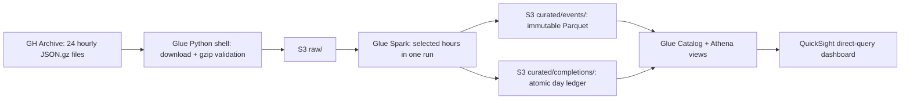

# GitHub PR openings: one UTC day

A small CIS551 project that turns 24 hourly [GH Archive](https://www.gharchive.org/) files into a reproducible AWS analysis. The default day is **October 15, 2024 (UTC)**. Every hourly source URL was checked before selecting it; the 24 compressed files total about 2.20 GiB. The source data stays in AWS during ingestion and processing.

The project answers four questions:

1. Which **archive hour** contains the most newly opened pull-request events?
2. Which repositories have the most openings across the day?
3. What percentage of openings belongs to the top 10 repositories?
4. How concentrated are openings among repositories in the busiest hour?

An archive hour means membership in a GH Archive file. The source event timestamp is preserved separately; delivery delays mean those two clocks need not match. Ties for busiest hour use the earliest UTC hour. Repository ties use repository name. Results are labeled **PROVISIONAL** until all 24 hours have completed.

## Architecture



There are no servers, crawlers, scheduled jobs, or persistent Spark clusters. Ingestion uses a 0.0625-DPU Python-shell job. ETL uses two G.1X workers, one concurrent run, no automatic retries and a 30-minute timeout. Athena has a dedicated workgroup with a 1-GiB query scan limit. All buckets block public access, require TLS and use SSE-S3 encryption. Project IAM roles can access only this project's bucket and relevant catalog/workgroup resources.

The dashboard has an overview table, an hourly bar chart, a top-repository bar chart, a busiest-hour repository-share chart, and a separate 24-hour completion table. It uses **DIRECT_QUERY**, so reopening the dashboard queries Athena again; there is no SPICE refresh job.

## What is counted

The Spark job keeps records with `type = PullRequestEvent` and `payload.action = opened`, a numeric event ID, a repository in `owner/name` form, and a parseable UTC timestamp. It counts one event ID per archive hour. Identical duplicate records collapse; conflicting records with the same ID and hour fail the batch. This measures observed opening events in the public archive, rather than every pull request on GitHub or private repository activity.

Each completed hour records raw rows, opening candidates, rejected candidates, duplicate candidates removed, valid openings, and completion time. Malformed JSON is included in the raw-row count when Spark can identify its source file; it cannot qualify as an opening candidate. A completed hour with no valid openings is **0**. A missing, running or failed hour is **MISSING**, with a null count.

## Prerequisites

- Terraform 1.10 or newer, below 2.0. The committed dependency locks select the AWS provider.
- Python 3.10+ and an AWS credential source supported by boto3/Terraform, such as a signed-in CloudShell or an AWS profile. Prefer Python 3.11 for parity with Glue 5.0.
- AWS access to S3, IAM, Glue, Athena and CloudWatch Logs in **us-east-2** by default. Region and project prefix are inputs.
- For the dashboard: QuickSight service access, an existing account subscription, and an existing AUTHOR or ADMIN user ARN in the same region. The deployment identity must be able to pass the project QuickSight role.

QuickSight enrollment is an account-level prerequisite, kept outside this stack. This project never creates, imports, replaces, cancels or deletes an account subscription. Deleting a QuickSight account subscription removes its assets across regions. If an AWS Organizations policy denies QuickSight, deploy and validate the core pipeline with `enable_quicksight = false`; the dashboard remains incomplete until that account restriction is resolved through the account's normal administration process.

## Rebuild from source

Clone the repository, create a virtual environment and install the operator dependency:

```sh
python3 -m venv .venv
source .venv/bin/activate
make install
```

Keep state, backend configuration and live variable files in a private directory **outside the clone**. Do not put credentials in Terraform files. The examples below use `/absolute/private/cis551`; replace that with a directory you own.

### 1. Bootstrap private remote state

Create an empty private directory, choose a globally unique state bucket name, and run the separate bootstrap stack. This stack's local state also belongs outside the repository:

```sh
terraform -chdir=terraform/bootstrap init
terraform -chdir=terraform/bootstrap apply \
  -state=/absolute/private/cis551/bootstrap.tfstate \
  -var='aws_region=us-east-2' \
  -var='state_bucket_name=YOUR-UNIQUE-STATE-BUCKET'
```

Copy `terraform/backend.hcl.example` to `/absolute/private/cis551/backend.hcl` and set that bucket name. It enables encryption and native S3 state locking (`use_lockfile = true`). The backend identity needs list access to the state bucket, read/write access to the state object, and read/write/delete access to its `.tflock` object. State versioning is enabled. The bootstrap bucket is protected from accidental Terraform destruction and is not part of project teardown.

### 2. Apply the core stack

Copy `terraform/project.tfvars.example` to `/absolute/private/cis551/project.tfvars`. Keep `enable_quicksight = false` for this first apply. Set the region and archive day, then run:

```sh
make init BACKEND=/absolute/private/cis551/backend.hcl
make fmt validate
make plan TFVARS=/absolute/private/cis551/project.tfvars
make apply TFVARS=/absolute/private/cis551/project.tfvars
make views
```

`make views` executes the SQL files in order. Terraform creates the Catalog tables and saves the same SQL as Athena named queries; named queries alone do not execute DDL. Views work before data is loaded, returning 24 missing hours. Applying the core before the dashboard ensures QuickSight's custom SQL can find those views.

### 3. Load and process the full day

```sh
make ingest                 # fetch and validate all 24 gzip files inside AWS
make etl                    # one Spark run for all 24 hours
make verify                 # reconcile completions, events and aggregates
```

Each command waits for its AWS run and prints its run/query IDs. Ingestion downloads one archive at a time to Glue's temporary disk, checks the entire gzip stream including its CRC, and then uploads it. Validated raw objects are reused on later runs. The runtime never needs the full day on local disk. To process only chosen hours, use `make etl HOURS=3,4,5`; this starts one Spark job for the selection.

Glue can briefly retain its concurrency slot after a run finishes. If `StartJobRun` explicitly rejects a new start with `ConcurrentRunsExceededException`, the operator waits in intervals of at most 10 seconds, for at most two minutes, before returning the last rejection. Once Glue accepts a run, the operator only polls that run; other start errors, including timeouts with an unknown outcome, are returned immediately.

The operator CLI reads initialized Terraform outputs. When running it somewhere without Terraform, export `terraform -chdir=terraform output -json` to a **private** file and pass `python scripts/run.py verify --outputs /absolute/private/outputs.json`.

### 4. Enable the real QuickSight dashboard

After the core views exist, set the following in the private variable file:

```hcl
enable_quicksight    = true
quicksight_user_arn = "arn:aws:quicksight:us-east-2:YOUR-ACCOUNT-ID:user/default/YOUR-USER"
```

Then run `make plan` and `make apply` with the same `TFVARS` argument. Terraform creates a source-specific IAM role, an Athena data source, five direct-query datasets and a dashboard with defined visuals and layouts. `terraform -chdir=terraform output -raw dashboard_url` prints its link. Sign in as the supplied QuickSight user and open both sheets. Confirm that all visuals load and match `make verify` before calling dashboard validation complete. No account-wide QuickSight service-role policy is modified.

## Demo: November 17, 2026, 7 p.m. New York time

The source day stays October 15, 2024 UTC. Before the demo, rehearse the full pipeline and recovery checks, then prepare the 23-hour starting point:

```sh
make repeat-check HOURS=23       # compare every logical event before/after retry
make failure-check DEMO_HOUR=23  # fail after write, verify missing, repair, compare
make prepare-demo DEMO_HOUR=23   # load all raw hours, process only hours 0..22
make verify EXPECTED_HOURS=23
```

`prepare-demo` explicitly resets that day's completion ledger before processing the other 23 hours. It therefore restores the partial starting point even after a successful full-day rehearsal. Existing raw data and previous immutable output files are retained; only the new completed batches are visible. Its reset is performed by the AWS ETL job through `--RESET_DAY=true`.

During the live demo:

1. Open QuickSight and show **23 completed / 1 missing**, with provisional totals. Show the raw final-hour object already in S3.
2. Run `make finish-demo DEMO_HOUR=23`. Only the missing hour starts a new Spark run; all previous completed hours stay visible.
3. Wait for Glue `SUCCEEDED` and the verification output. Reopen the dashboard so direct queries reload.
4. Show **24 completed / 0 missing**, read the busiest hour, top repositories, top-10 percentage and busiest-hour concentration. Explain the two different denominators: full completed day versus busiest hour.

If the live run fails, the final hour remains missing and the report stays provisional. Inspect its run ID and logs, then rerun `make finish-demo`. A failed run is not a completed hour.

## Repeat and failure behavior

The ETL first atomically rewrites that day's completion ledger without the selected hours. It then reads and validates their inputs and writes immutable Parquet under a fresh batch ID. Only after the write succeeds does one S3 put atomically publish all selected hours and their counts. Every analytical event view joins on day, hour **and batch ID**. Failed or superseded files therefore cannot inflate results. Unselected hours keep their previous completions throughout the run.

The completion ledger is small newline-delimited JSON, one object per source day. The job's one-run concurrency limit serializes its read/modify/write cycle. Do not create a second job or run a separate copy against the same bucket. Ingestion should finish before ETL starts. For a different source day, change the Terraform input, apply, reinstall views, and ingest/process that day.

Immutable Parquet from superseded and failed runs is retained for inspection. Repeated runs increase storage and Athena scan volume; this bounded course project intentionally avoids a separate compaction service. Reports always select only completed batches. Project teardown deletes these files when explicitly requested.

## Verification

Deployment checkpoint, **November 7, 2026**, in Ohio (`us-east-2`):

| Check | Observed result |
| --- | --- |
| Terraform formatting and validation | Passed for the project and separate state bootstrap |
| Offline regression tests | All nine passed: five Spark/Parquet/SQL tests and four operator tests |
| Full-day ingestion and Spark processing | Succeeded for all 24 archive files |
| Raw-row reconciliation | 5,378,686 source rows; all 24 object row counts matched Spark |
| Athena full-day reconciliation | 189,818 valid opening events; 24 completed hours, no rejected or duplicate openings |
| Busiest archive hour | 14:00 UTC, with 9,708 openings |
| Top-10 repositories' share of the day | 3.3690% |
| Largest repository share in the busiest hour | `Nix-Drone/mergequeue-github`, 1.0404% |
| Reprocess hour 23 | Every logical event matched the original full-day hash |
| Deliberate failure after Parquet write | Failed hour became missing/null; other 23 hours stayed identical; repair restored the original full-day hash |
| Presentation rehearsal | Prepared and verified 23 hours; final-hour run restored 24 hours and 189,818 openings |
| Final-hour processing time in this rehearsal | 122 seconds of Glue execution, about 2 minutes 15 seconds from start to completion |
| Core infrastructure drift | No changes after deployment |
| Teardown preview | Only the 22 core project resources; no deletion executed |
| QuickSight deployment and visual inspection | Pending account access: AWS Organizations explicitly denies QuickSight until the account administrator resolves the restriction |

The full-day logical-event SHA-256 after both repeat and recovery checks was `d7804e32da48b85d19c7b139db2187e474b4188014b858ad277b9a8d7c6337e6`. Deployment state, credentials and detailed run logs are kept privately outside this repository. The dashboard remains unverified; successful Glue and Athena runs do not establish that QuickSight works.

The rehearsal's first immediate final-hour start was rejected by Glue's concurrency limit after the preparation job had reported success. A later start succeeded. The bounded start retry described above was added afterward and verified with botocore-stub tests, including exhaustion and unrelated/ambiguous errors. That specific retry path has not yet been reproduced live with the updated operator. The stack is currently left at the complete 24-hour result, with no active Glue runs, for account-owner validation. No teardown has been executed.

To run the local checks and inspect a deployed stack yourself:

```sh
python3 -m pip install -r requirements-test.txt
# Java 17 must be available; JAVA_HOME may point at a standalone runtime.
make test
make fmt validate
make verify
```

The offline tests execute real Spark JSON parsing and Parquet writes across 24 fixture hours, then execute the project's SQL in DuckDB. They cover full-day totals, hour/repository ranking, top-10 share, concentration denominators, malformed/rejected records, duplicates, completed zero versus missing, all-hours versus split runs, repeat logical equality, conflicting event IDs, gzip corruption, and recovery after output succeeds but completion publication fails. DuckDB verification complements actual Athena execution; it does not prove AWS permissions or QuickSight rendering.

The live `verify` command checks 24 status rows, expected completion coverage, equality of completion/event/repository totals, unique visible event IDs per hour, and busiest-hour reconciliation. `repeat-check` hashes all sorted logical event rows before and after the run. `failure-check` verifies the failed hour disappears, other hours remain equal, and repaired output returns to the original hash. These checks start real Glue jobs and incur their normal AWS charges.

CloudWatch logs for Spark use `/<project-name>/output` and `/<project-name>/error`, retained for 14 days. Python-shell system logs use AWS's shared `/aws-glue/python-jobs/` groups; project teardown does not delete shared log groups. Athena query results expire after seven days and Spark temporary objects after two days. Raw and curated data remain available for personal validation until teardown.

## Optional teardown, after personal validation

Resources are intentionally left deployed. There is no automatic cleanup schedule. When ready, inspect the exact project plan and use the same private variable file and backend that created the stack:

```sh
make plan-destroy TFVARS=/absolute/private/cis551/project.tfvars
make destroy TFVARS=/absolute/private/cis551/project.tfvars
```

`plan-destroy` only previews removal; it does not save a change to state. `destroy` runs two operations with the same private variable file:

1. `terraform apply` with `allow_bucket_destroy=true` saves the bucket's `force_destroy` setting in state. This preparatory apply also includes any pending stack changes, so review its full plan before confirming.
2. `terraform destroy` with the same flag removes the project stack and empties the **project bucket**. Passing the flag only to destroy is insufficient because the AWS provider needs the setting already saved in state.

Both operations retain Terraform's normal interactive confirmation. If the preparatory apply fails or is canceled, Make stops before destroy. If you stop after a successful apply, run normal `make apply` with the same `TFVARS` to restore the default protection for bucket contents.

Teardown removes the project bucket and its contents, project jobs, Catalog database/tables/views, workgroup/named queries, project IAM roles/policies, project log groups and enabled project QuickSight assets. It leaves the separate state bucket, unrelated resources, QuickSight user/namespace, and QuickSight account subscription alone. Subscription billing and cancellation require separate account administration; deleting this stack does not cancel a subscription.

## Reading order

- `terraform/main.tf`: storage, jobs, Catalog and Athena workgroup.
- `jobs/ingest.py`: bounded downloads and raw-input validation.
- `jobs/etl.py`: filtering, counts and the completion boundary.
- `sql/`: the five analytical views, in dependency order.
- `terraform/quicksight.tf`: datasets, permissions and visible dashboard layout.
- `scripts/run.py` and `Makefile`: repeatable operations and live checks.
- `tests/test_pipeline.py`: a complete input-to-result and failed-retry example.

References: [GH Archive](https://www.gharchive.org/), [Glue Python shell](https://docs.aws.amazon.com/glue/latest/dg/add-job-python.html), [Glue 5.0 logging](https://docs.aws.amazon.com/glue/latest/dg/monitor-continuous-logging.html), [source-specific QuickSight roles](https://aws.amazon.com/about-aws/whats-new/2023/02/amazon-quicksight-role-based-access-control-data-sources-s3-athena/), [direct-query refresh behavior](https://docs.aws.amazon.com/quick/latest/userguide/refreshing-data.html), [Terraform S3 backend locking](https://developer.hashicorp.com/terraform/language/backend/s3).
